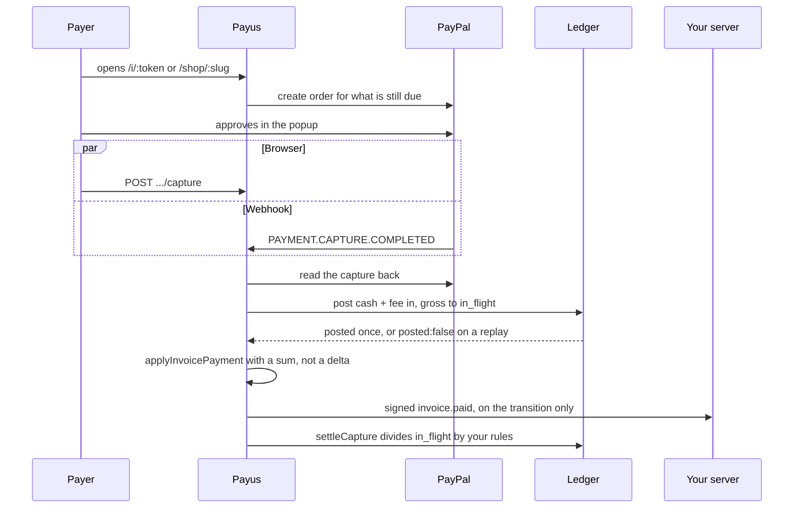
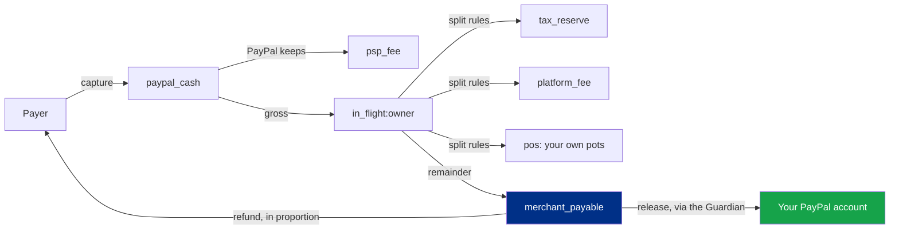

<p align="center">
  <picture>
    <source media="(prefers-color-scheme: dark)" srcset="web/public/assets/payus-white.svg" />
    
  </picture>
</p>

<h1 align="center">Payus</h1>

<p align="center">
  Get paid with a username, a link, an invoice or a widget — and let a team of AI agents do the paperwork around the money without ever being the thing that moves it.
</p>

<p align="center">
  <a href="https://payus-plum.vercel.app"></a>
  <a href="https://github.com/maulana-tech/payus-app"></a>
  <a href="#the-money-path"></a>
  <a href="#the-council-of-twelve"></a>
  <a href="#the-ledger-in-eight-accounts"></a>
  <a href="#does-the-guard-actually-hold"></a>
  <a href="#hackathon-submission"></a>
</p>

---

Payus is a payments app with **twelve seats at one table**. Six of them are plain
deterministic code and they are the ones on the money path: taking the payment,
reading the capture back from PayPal, posting double entry, signing your webhook,
issuing the recurring invoice, refusing what breaks a rule. The other six are
**Claude**, and every one of them writes something down and stops — a split, a
payout, a report, a shop page, a follow-up letter, an answer out of your own books.

> **No model moves money in this application, and that is structural rather than
> promised.** Every movement is written as a **proposal** and decided by
> `features/guardian/decide.ts` — a pure function given the proposal, the limits
> you set and the facts, answering `allow`, `ask` or `refuse` with the reason it
> used.
>
> - An agent **holds no limits of its own.** A second copy of the limits inside a
>   prompt would be a second, drifting source of truth
> - Every figure comes from the ledger. The Reporter may not state a number it was
>   not handed — including a correct subtraction, because working one out is the
>   thing that seat must not do
> - A destination must be one we already showed it. That is a check after parsing,
>   not a line in the prompt
> - Consent is bound to `sha256` of the proposal it was given for, so a proposal
>   amended after approval cannot inherit it
> - A prompt injection's best case is a **proposal that gets refused, with the
>   refusal written down**

**Status:** the rail works end to end — a sandbox payment goes through PayPal,
posts itself to the ledger and settles the invoice, once, however many times the
event is delivered. Releases are recorded as `payout.simulated` and labelled as
such everywhere until PayPal approves the Payouts permission on the account; that
label is never dressed up as a real payout.

---

## What makes Payus different

### Who this is for

Meet Arif, who roasts and sells coffee in Bandung and takes on a little design work
on the side. He is paid four ways in a month: a transfer from a regular café, an
invoice to a client abroad, a link he drops in a WhatsApp chat, and cash at a market
stall. Three of those four end with him squinting at a screenshot to decide whether
he has actually been paid.

The money lands in one balance. He knows roughly what he owes in tax, and he knows
he should put it aside the moment a payment arrives, but the moment a payment
arrives is also when the gas bottle needs refilling. Two clients are late; writing
the second reminder costs him more than the invoice is worth, so he does not write
it. He would like a shop page, has no designer, and the page builders he tried want
his whole catalogue typed into their database.

He has read about AI agents that manage money. Every one of them wanted a key.

Arif's problem is not a missing feature. It is that **everything around a payment —
knowing it landed, dividing it, chasing it, writing it up — is work he has to redo
for every single payment**, at the worst possible moment, and the tools that offer
to help want custody.

### The problem

- **Being paid and knowing you were paid are two different jobs.** The second one is
  usually done by eye, from a screenshot, late
- **Money that arrives in one pot gets spent.** Tax worked out at the end of the
  quarter is a guess against money that is already gone
- **Chasing a late invoice is emotional labour**, so it is done badly, or not at all
- **A shop page is a project.** Most sellers want one page with four things on it and
  a button that works
- **A refund quietly breaks the arithmetic.** Tax set aside on a sale that was undone
  is not tax, but almost nothing reverses a split properly
- **"AI finance agents" ask for your keys.** A prompt is not a security boundary, and
  a model that can send money is a model that can be talked into sending money

**How might we put a team of agents around someone's money — doing the dividing, the
chasing, the writing and the building — while making it structurally impossible for
any of them to move a cent?**

### The solution

**1. One rail, four doors.** A `@username`, a reusable payment link, an invoice with a
public page, a shop page, and a checkout API for someone else's site. All of them
end at the same writer: `recordCapture()`. There is no second path into the books.

**2. A ledger that is the source of truth, not a report.** Double entry in integer
minor units. A transaction that does not balance is refused before the database is
touched; a transaction id posts exactly once, so a replayed webhook writes nothing
at all. `trialBalance()` is `0n` or the suite fails.

**3. Six deterministic seats on the money path.** Everything that touches money is
code you can read: the order, the capture read back from PayPal, the posting, the
signed webhook, the schedule, the Guardian. The clever ones sit beside the rail, not
on it.

**4. A Guardian that is a function.** Per-payment and per-day ceilings, an
approval threshold, a recipient the Guardian has not met, every rule evaluated —
not just the first to fire — so the audit says everything that was wrong. Consent is
bound to a hash. The owner's own Release button goes through it, so the road the
agents will take is already the one in daily use.

**5. Everything on the record.** Proposals with their verdict and reason, an audit
log, a webhook delivery log, the rows an answer was computed from printed under the
answer, and a settlement report whose last line compares the PayPal cash account's
own movement against what the categories say it should have been — and **shows the
difference** when they disagree, because a posting the report has no category for is
exactly the thing worth hearing about.

---

## The council of twelve

Twelve seats in the order a payment travels. The table on the landing page is
generated from `web/src/components/landing/editorial/agents.ts`, so a claim there is
a claim about this repository.

| # | Seat | Role | Runs on | What it may do |
|---|---|---|---|---|
| 1 | **Teller** | Takes the payment | Code | Opens a PayPal order for exactly what an invoice still owes, captures it on approval |
| 2 | **Courier** | Carries the news | Code | Reads the capture back from PayPal before anything is believed; claims work with a row lock, 8 tries |
| 3 | **Ledger** | Keeps the books | Code | Posts double entry in minor units; refuses an unbalanced transaction, posts an id once |
| 4 | **Herald** | Tells your server | Code | Signs and delivers `invoice.paid` / `checkout.paid`, retries, keeps the log |
| 5 | **Scribe** | Writes the invoices | Code | Issues the next recurring invoice and the overdue reminder, claimed not merely read |
| 6 | **Guardian** | Refuses what breaks a rule | Code | Decides every proposal. Cannot write one, cannot edit one |
| 7 | **Allocator** | Proposes the split | Claude | Writes a `split.change` proposal. Rounding is settled in code |
| 8 | **Payer** | Pays what is due | Claude | Writes a `payout` proposal for a destination we showed it |
| 9 | **Reporter** | Writes the day down | Claude | Prose over figures it was handed. One unknown number throws the report away |
| 10 | **Builder** | Builds the storefront | Claude | Proposes a shop: config plus a page written as blocks. The owner applies and publishes |
| 11 | **Collector** | Chases the overdue | Claude | Drafts the follow-up. Whether to write at all is decided in code; you send it |
| 12 | **Advisor** | Answers from the books | Claude | Picks one of six queries by name; we run it scoped to you and show the rows |

### What each limit actually is, and where it lives

A limit written in a prompt is a request. Every one of these is a check in code that
runs whether or not the model cooperated.

| Seat | The limit | Where it lives |
|---|---|---|
| **Payer** | The destination must be one we showed it | A lookup after parsing, in `payer.agent.ts` |
| **Payer** | Amount, day total, new recipient, expiry | `decide()` — the agent holds none of them |
| **Allocator** | A total share across rules; the daily total | `decide()`, because only the Guardian sees across rules |
| **Allocator** | A per-item bound | The agent's own zod schema |
| **Reporter** | Every figure must have been handed over | `unknownNumbers(report, figures)` |
| **Collector** | Whether to write at all | `stopReason(invoice, now)` — pure, reached before the model |
| **Collector** | Three letters, then silence; a quiet week between | The same function; the count rises where **you** press send |
| **Advisor** | Cannot write the query | An `enum` of six names, then a `Map` lookup |
| **Advisor** | No write path of any kind | There is no mutation on that router |
| **Builder** | Cannot write markup | It writes **blocks**; `toHtml()` is the only writer |
| **Builder** | Cannot write a web address | It names one of your pay links; we resolve the key |
| **Builder** | Cannot decide what is wrong with a page | `findings.ts` computes them; it is handed one by id |
| **Builder** | Cannot delete your hand-written design | `mergeEdit()` puts those blocks back by index |
| **Everyone** | The shape is validated twice | The API constrains it, then zod decides whether to act |

### One proposal, end to end

```
agent (Claude)
  ├─ facts assembled from the ledger by code  →  never "remember a balance"
  ├─ structured output, constrained by the API
  ├─ zod: is this an answer this application will act on at all?
  ├─ destination check: is this one we showed it?
  ▼
proposal written to the database  (kind, payload, hash)
  ├─ decide(proposal, policy, context)        →  pure, every rule evaluated
  │     allow   → execute now
  │     ask     → waits for you, in the dashboard or on Telegram
  │     refuse  → recorded with its findings, then thrown
  ▼
approval is logged against sha256(canonical(payload))
  ├─ execute() re-compares the hash         →  mismatch = approval.void
  ▼
executor: payout batch id = sha256(owner|amount|currency|destination|intentKey)
  └─ ledger transaction `payout:<batch>` can only land once
```

---

## Does the guard actually hold?

Not an argument — a suite. **483 tests across 71 files**, run with a local Postgres so
the six database-backed files are not skipped. Each guarantee below is held down by a
file named after it, and each agent's file is its eval set: a case is added there
rather than trusting the prompt.

| Guarantee | Checked by | Tests |
|---|---|---|
| A capture posts once, however many ways it arrives | `moneyPath.test.ts` — real ledger, real invoice logic, only PayPal stubbed | 8 |
| The books balance, and a replay writes nothing | `ledger.test.ts` | 8 |
| A split loses no cent and invents none | `split.test.ts` | 13 |
| A refund comes out of the pots the capture went into | `refundReversal.test.ts`, `refundPath.test.ts` | 11 |
| Allow / ask / refuse, every rule, hash-bound consent | `guardian.test.ts`, `guardianFlow.test.ts` | 23 |
| The Payer's destination rule and its decision path | `payerAgent.test.ts` | 11 |
| The Allocator's bounds | `allocatorAgent.test.ts` | 10 |
| A figure the Reporter was not given throws the report away | `reporterAgent.test.ts` | 6 |
| The Collector stops before the model is reached | `collectorAgent.test.ts` | 6 |
| The Advisor picks a query and never writes one | `advisorAgent.test.ts` | 5 |
| The Builder's blocks, addresses, merges and refusals | `shopAgent.test.ts`, `storefront.test.ts` | 56 |
| Every block kind survives HTML **and** the sanitiser, twice | `storefrontBlocks.test.ts` | 14 |
| What the sanitiser refuses, and what it reports taking out | `sanitizeShopHtml.test.ts` | 17 |
| The sandbox tokens on the shop iframe | `storefrontRender.test.tsx` | 4 |
| Our migration runner agrees with drizzle's own | `migrations.test.ts` | 1 |
| The SDK's signature check agrees with the server's | `sdk.test.ts` | 7 |

**What is not measured, and should be said plainly.** There is no replay against
market data, because nothing here forecasts anything. The prose the thinking seats
write is not scored — it is *bounded*: the Reporter's figures are checked, the
Collector's draft is held to the same check, the Advisor's rows are shown. And the
Payouts permission is not approved on the sandbox account, so the last hop of a real
release is the one thing in this list exercised only against PayPal's error path.

---

## Features

**Being paid**

- **`@username`**, claimed with a signature only your browser can make — the server
  stores the claim and cannot forge it
- **Payment links** with a fixed or an open amount, and a QR code
- **Invoices**, one-off and recurring, with a public page at `/i/<token>`, overdue
  reminders, a PDF, and CSV
- **Payment requests** between usernames, sealed with X25519 + AES-GCM so the server
  only ever sees who asked whom
- **A shop page** at `/shop/<slug>`: items, quantities, sold-out states, bounds on
  what a payer may name
- **A checkout API** for your own site, `POST /api/v1/checkouts`, API-key authed
- **An embed widget**: `public/embed.js`, one script tag, no build step, no dependencies
- **Our own PayPal button** — the v6 Web SDK, so the payer never leaves our page for a
  panel we do not control

**What happens to the money**

- **Double entry** in integer minor units with an ISO 4217 code. No floats, anywhere
- **Your own splits**: a share for tax, a pot of your own, a platform fee — percentages
  settled by largest remainder, the remainder yours
- **Release what is left**, through the Guardian, and never twice
- **Refunds in proportion**, read back from the settlement's own ledger entries rather
  than recomputed from today's rules; the invoice is owed again and no second receipt
  goes out
- **A settlement report** by day — taken, fees, refunded, set aside, yours, released —
  with a reconciliation line, identical on screen, in the CSV and in the PDF
- **A transactions grid** over real ledger entries, footed on both columns

**The agents**

- **Proposals, not actions**, for all six thinking seats
- **Approvals in a chat**: link a Telegram chat with a single-use code and decide there;
  the buttons call the same functions the dashboard's do
- **A shop you can argue with**: ask the Builder for a page, then ask for changes — the
  page on the right *becomes* its answer until you apply or discard it, follow-ups carry
  on from what you are looking at, and the thread is kept next to the page, refusals
  included
- **Fixes it is allowed to attempt** are computed by this app — a button that goes
  nowhere, a page that says nothing, an unpriced item — because a model asked what is
  wrong will always find something. Each finding says whether it is the Builder's to fix
  or yours
- **Files you bring**: a CSV or a statement is parsed by hand, and reconciliation against
  it is arithmetic with no model anywhere near it

**The editor**

- **`/canvas/[id]` is the whole window**: controls on the left, the shop's real page on
  the right at a phone's, a tablet's or the full width — the same component the public is
  served
- **Twenty block kinds**, reordered by dragging or by the move buttons beside each row,
  because a list you can only drag is a list a keyboard cannot reorder
- **Three ways to edit, one stored field**: blocks are a reading of the HTML, the HTML is
  what the blocks write, and you can click the words in the preview and type
- **A pasted design survives**, kept whole as a verbatim block rather than chopped into
  fields that would lose it
- **An address is chosen, never typed** — your own links, shops and profile, offered by name

**Keys and identity**

- **Privy** for login, then a **passkey (PRF)** or a 6-digit **PIN** that derives an
  account master *in the browser*; signing, messaging and vault keys are derived from it
  and nothing secret reaches the server

### What is deliberately not here

Yield and treasury, subscriptions, multi-currency, KYC, custody, and an embedded wallet.
Payus moves money between PayPal accounts and a ledger; holding someone's funds is a
different promise and a different licence.

Without a model configured the six thinking seats are simply **off and say so**. The
rail is unaffected.

---

## Tech stack

| Layer | Technology |
|---|---|
| Framework | Next.js 15.5 App Router, React 19, Turbopack in development |
| API | tRPC 11, plus REST where someone else's server has to call it |
| Database | Postgres via Drizzle ORM 0.45; money as `numeric(20, 0)` minor units |
| Payments | PayPal Orders v2, Payouts, and the **v6 Web SDK** for our own button |
| Models | Claude (`@anthropic-ai/sdk`) over the first-party API **or** Amazon Bedrock |
| Identity | Privy for login; Ed25519 / X25519 / Argon2id in the browser via `@noble/*` |
| UI | Tailwind v4, Base UI, lucide, Motion, AG Grid, CodeMirror, sonner |
| Validation | zod 4 everywhere, including as the second gate on every model answer |
| Email / chat | Resend; Telegram Bot API for approvals |
| Tests | Vitest 483 tests / 71 files, happy-dom for components, throwaway Postgres for services |
| Tooling | Biome (lint + format of record), pnpm 10, Node 22 |
| Deploy | Vercel, or the `Dockerfile` + `render.yaml` blueprint anywhere else |

---

## PayPal integration

| Component | File | What it does |
|---|---|---|
| **Order** | [`payments.service.ts`](web/src/server/modules/payments/payments.service.ts) | `startPaypalOrder()` opens an order for exactly what is still due and writes a `payments` row with a unique `order_id` |
| **Capture** | the same file | `capturePaypalOrder()` and the webhook both converge on `recordCapture()` — one writer, two roads |
| **Our own button** | [`PayPalButton.tsx`](web/src/features/payments/PayPalButton.tsx) | PayPal's **v6 Web SDK**: `createInstance` → `createPayPalOneTimePaymentSession(...).start()` inside the click handler, so the popup is opened by the click |
| **Webhook** | [`api/webhooks/paypal`](web/src/app/api/webhooks/paypal/route.ts) | Verified with PayPal, stored under its `event_id` as a primary key, outbox work queued in the same transaction |
| **Amounts** | [`handlers.ts`](web/src/server/modules/outbox/handlers.ts) | The worker reads the capture back from PayPal. A webhook body is a hint, never a number |
| **Settlement** | [`settlement.service.ts`](web/src/server/modules/ledger/settlement.service.ts) | Divides `in_flight` by your rules, inline for speed, queued if that throws |
| **Payout** | [`payouts.service.ts`](web/src/server/modules/payments/payouts.service.ts) | `sender_batch_id = sha256(owner\|amount\|currency\|destination\|intentKey)`; without the permission, recorded as `payout.simulated` |
| **Refund** | [`refunds.service.ts`](web/src/server/modules/payments/refunds.service.ts) | Three locks, because there are three ways to arrive at the same refund |
| **Checkout API** | [`api/v1/checkouts`](web/src/app/api/v1/checkouts/route.ts) | API-key authed, for someone else's server |
| **Permission probe** | [`probePayoutsAccess()`](web/src/server/lib/paypal.ts) | Asks PayPal whether Payouts is approved — a 404 got past authorisation, a 401/403 is the permission being refused — so the answer appears **before** the button is pressed |

## Claude integration

| Component | File | What it does |
|---|---|---|
| **The one call site** | [`server/lib/claude.ts`](web/src/server/lib/claude.ts) | `askForJson()`: model, effort, `thinking: {type: "adaptive"}`, **structured outputs**, `maxTokens`, streaming above 8192, and a truncation reported with its token counts |
| **Allocator** | [`allocator.agent.ts`](web/src/server/modules/agents/allocator.agent.ts) | Proposes how arriving money is divided |
| **Payer** | [`payer.agent.ts`](web/src/server/modules/agents/payer.agent.ts) | `payerFacts()` from the ledger, then a payout proposal |
| **Reporter** | [`reporter.agent.ts`](web/src/server/modules/agents/reporter.agent.ts) | `unknownNumbers()` is the whole guarantee |
| **Builder** | [`builder.agent.ts`](web/src/server/modules/agents/builder.agent.ts) | Generate, edit and fix a shop; `agentPage.ts` is the whole of what it may write |
| **Collector** | [`collector.agent.ts`](web/src/server/modules/agents/collector.agent.ts) | `stopReason()` decides; the model only drafts |
| **Advisor** | [`advisor.agent.ts`](web/src/server/modules/agents/advisor.agent.ts) | Picks one of six queries by name; the rows become the only figures it may use |
| **The thread** | [`builderHistory.service.ts`](web/src/server/modules/agents/builderHistory.service.ts) | Twenty turns per shop, the page kept on the newest alone, scoped by owner **and** shop |
| **Guardian** | [`features/guardian/decide.ts`](web/src/features/guardian/decide.ts) | Pure. Knows nothing about agents, which is the point |

> **One thing worth knowing if you fork this.** Bedrock's structured outputs are a
> *subset* of JSON Schema: `enum`, `pattern` and `maxLength` are accepted, while array
> `minItems`/`maxItems` and numeric `minimum`/`maximum` are **rejected with a 400**.
> Those bounds live in the zod schema — which is what decides whether an answer is
> acted on anyway — and the range is stated in the property's description so the model
> still knows it.

---

## Architecture

### A payment, end to end



### Where the money can go



Every arrow that leaves Payus ends at the owner's own PayPal account or back at the
payer. There is no third destination, and the Guardian sits on the only one of those
two an agent can ever propose.

### The shape of the code

```
web/src/features/     framework-free domain logic — money, splits, refunds,
                      reports, blocks, findings, the Guardian's decide()
web/src/server/       tRPC modules (router → service → schema → errors),
                      one file per agent seat, Drizzle schema + migrations
web/src/app/          App Router: the dashboard group, the canvas group,
                      public pay/invoice/shop pages, embed pages, REST + cron
web/src/components/   screens, the canvas, the landing's editorial language
packages/js/          @payus/js — dependency-free, fetch + Web Crypto
```

---

## Setup

### Requirements

- **Node 22+** and **pnpm 10** (`corepack pnpm …` works if pnpm is not on PATH)
- **Postgres** — local for development, Neon or Render in production
- A **Privy** app id, and **PayPal sandbox** credentials from
  developer.paypal.com → Apps & Credentials
- Optional: an **Anthropic API key** *or* AWS credentials for Bedrock (without
  either, the six thinking seats are off and say so); a **Resend** key for email;
  a **Telegram** bot token for approvals

### Run it

```sh
pnpm install
cp web/.env.example web/.env.local     # Privy app id + DATABASE_URL at minimum
pnpm --filter web db:migrate           # must run before the first boot
pnpm dev                               # Next.js on :3000
```

To look around without setting up an identity provider at all, add
`NEXT_PUBLIC_DEMO_USER=demo` to `web/.env.local` and `POST /api/dev/seed` —
development only, and [`docs/setup.md`](docs/setup.md) says exactly why that is safe
(`demoUser()` also checks `NODE_ENV`, which a production build hard-codes).

### Scripts

```sh
pnpm --filter web test                                   # vitest run (483 tests)
pnpm --filter web exec vitest run test/money.test.ts     # one file
pnpm --filter web exec vitest run -t "name"              # one test by name
pnpm --filter web exec tsc --noEmit                      # typecheck
pnpm --filter web biome:check                            # lint + format check
pnpm --filter web build                                  # standalone output
pnpm --filter web db:generate                            # after editing schema.ts
pnpm build:sdk                                           # packages/js
node web/scripts/webhook-receiver.mjs                    # a local sink for webhooks
```

> **Two traps worth knowing.** Run the suite with a **Postgres up**, or the six
> service files that need one skip themselves and you lose the ledger, money-path and
> migration guarantees without being told. And `pnpm build` needs a **syntactically
> valid** `NEXT_PUBLIC_PRIVY_APP_ID` (25 characters): the provider calls Privy while
> prerendering `/`, so a bogus id fails the build — the fix is a real id, not making
> pages dynamic.

Full guides: [setting it up](docs/setup.md) · [accepting payments](docs/api.md).

---

## How it works

### Merchant flow

```
Sign in → claim @username → make a link, an invoice or a shop → get paid → split → release
```

1. **Sign in** with Privy, then unlock with a passkey or a PIN — the account master is
   derived in the browser
2. **Claim a `@username`**: your browser signs the claim, the server stores it
3. **Open a door**: a payment link, an invoice, a shop at `/shop/<slug>`, or an API key
   and a `POST /api/v1/checkouts` from your own server
4. **Be paid**: the capture posts itself and the invoice settles, once
5. **Divide and release**: your split rules run on arrival; what is left is yours to
   release, through the Guardian

### Payer flow

```
Open the page → press pay → approve in the popup → the page says paid
```

Nothing a payer's browser sends is trusted. A shop order re-reads the item: sold out
refuses, a quantity is held to that item's own limit, a payer-named amount must sit
inside the shop's bounds, and `MAX_ORDER_MINOR` caps any single order however it was
reached. The browser may send **which** item, never a price.

### Agent flow

```
Facts from the ledger → a proposal → decide() → allow, ask or refuse → execute → audit
```

1. **Ask**, or let a schedule ask: a split for money that just landed, a payout that is
   due, the day written up, a shop, a follow-up letter, a question about your books
2. **The shape is validated twice** — the API constrains it, then zod decides whether
   this application will act on it at all
3. **The Guardian decides**, evaluating every rule, and records the reason
4. **An `ask` waits for you** in the dashboard or on Telegram, and your approval is bound
   to the hash of what you approved
5. **Nothing a thinking seat produced is ever written by it.** Not the page, not the
   payout, not the letter

### Shop flow

```
Describe it → read the page → argue with it → apply → publish
```

1. **Five starters** or a sentence to the Builder; a starter is rendered through the real
   page component while you are still choosing
2. **The canvas**: blocks, HTML or the page itself — three views of one stored field
3. **Ask for changes.** The page on the right becomes the answer; follow-ups refine what
   you are looking at; your pasted markup is put back where it was
4. **Fix** is only ever a check this app computed, and each one says whose it is to fix
5. **Publish** when it reads right. Putting a price in front of the public is a
   commercial decision, so it is not the model's

---

## The money path

Four steps, and only the last two may change what anyone is owed.

| # | Step | Rule that holds it together |
|---|---|---|
| 1 | **Order** — `POST /api/payments/paypal/orders` | One PayPal order per `payments` row, `order_id` unique |
| 2 | **Capture** — the browser, or the webhook, or both | Both converge on `recordCapture()`; the amounts are read back from PayPal |
| 3 | **Posting** — cash and fee in, gross to `in_flight` | `ledger_txns.id` is `capture:<captureId>`, so a replay returns `{posted: false}` |
| 4 | **Settlement** — `in_flight` divided by your rules | Pure arithmetic in `features/split/evaluate.ts`; Σ allocations === the amount in |
| 5 | **Refund** — the way back | Reversed from the settlement's **own** entries; three refunds of a third add up exactly |

### The ledger, in eight accounts

Account ids are **derived, never typed** — the id tells the ledger an account's kind
and its normal side.

| Account | Kind | Holds |
|---|---|---|
| `paypal_cash` | asset | Money sitting at PayPal |
| `psp_fee` | expense | What PayPal kept out of a capture |
| `platform_fee` | revenue | Our cut |
| `in_flight:<owner>` | liability | Captured for this merchant, not yet split |
| `tax_reserve:<owner>` | liability | Set aside for tax |
| `merchant_payable:<owner>` | liability | Owed to the merchant, awaiting payout |
| `pos:<owner>:<slug>` | liability | One of the owner's own pots |
| `external` | — | Anything outside this system |

`balance()` reports in each kind's normal direction, so assets and liabilities both
read positive; `rawBalance()` is debit − credit for when you want the truth unprettied.

---

## The API surface

| Endpoint | Auth | For |
|---|---|---|
| `POST /api/v1/checkouts` | API key | Create a checkout from your own server |
| `GET /api/v1/checkouts/:id` | API key | Read one back |
| `POST /api/payments/paypal/orders` | the invoice token | Open an order for what is due |
| `POST /api/payments/paypal/orders/:id/capture` | the invoice token | Capture it |
| `POST /api/payments/paypal/links` | public | An order for a payment link |
| `POST /api/payments/paypal/storefront` | public | An order for a shop item |
| `POST /api/webhooks/paypal` | PayPal-verified | Captures and refunds |
| `POST /api/webhooks/telegram` | `X-Telegram-Bot-Api-Secret-Token` | Approval buttons |
| `POST /api/cron/invoices`, `/api/cron/outbox` | `Bearer $CRON_SECRET` | Scheduled work |
| `GET /api/health` | public | 200 only when the database answers too |
| `/api/trpc/*` | Privy access token | The dashboard's own API |

Webhooks we send are signed Stripe-style: `Payus-Signature: t=…,v1=…`, with retries
and a delivery log you can read. [`@payus/js`](packages/js) verifies them —
dependency-free, `fetch` and Web Crypto only, amounts never floats, and
`constructEvent` **throws** rather than returning null, because acting on an
unverified event is the one mistake worth designing against. `web/test/sdk.test.ts`
imports both sides, since a client library that agrees only with itself is how this
goes wrong.

---

## Deployment checklist

- [x] Login, passkey/PIN unlock, account master derived in the browser
- [x] Signed `@username` claims, verified by the payer
- [x] Payment links, invoices (one-off, recurring, reminders), sealed requests
- [x] PayPal Orders v2 with our own v6 SDK button; capture from the browser **and** the webhook, converging on one writer
- [x] Double-entry ledger, integer minor units, `trialBalance() === 0n`
- [x] Idempotent everywhere: `event_id`, `capture:<id>`, deterministic `sender_batch_id`
- [x] Splits with largest-remainder rounding; proportional refunds read from the settlement's own entries
- [x] Settlement report + reconciliation line, identical on screen, in CSV and in PDF
- [x] Merchant API keys, checkout API, signed webhooks with retries and a delivery log
- [x] Embed widget, no build step, no dependencies
- [x] Guardian: allow / ask / refuse, every rule evaluated, consent bound to a hash
- [x] Twelve seats filled — six deterministic, six proposing
- [x] Telegram approvals through the same functions as the dashboard
- [x] Storefronts: five starters, the canvas, twenty block kinds, drag to reorder, sanitiser + sandboxed iframe
- [x] Builder generate / edit / fix, with the thread kept per shop
- [x] Files people bring: CSV and statement parsing, reconciliation with no model near it
- [x] 483 tests / 71 files, typecheck and Biome clean
- [x] Deployed: [payus-plum.vercel.app](https://payus-plum.vercel.app); `Dockerfile` + `render.yaml` for anywhere else

**One limitation worth naming.** The **Payouts** permission is not approved on the
PayPal sandbox account, so a release is recorded as `payout.simulated` and labelled
that way in the UI, in the report and in the CSV — counted separately from a real
payout everywhere it appears. Nothing else is simulated: the capture, the posting,
the split and the refund all run for real against the sandbox. When the permission
lands, `PAYPAL_PAYOUTS_ENABLED=true` is the whole change.

---

## Hackathon submission

| | |
|---|---|
| **Event** | PayPal AI Hackathon 2026 |
| **Payments** | PayPal Orders v2, Payouts, v6 Web SDK, verified webhooks |
| **Models** | Claude, over the first-party API or Amazon Bedrock |
| **Live demo** | [payus-plum.vercel.app](https://payus-plum.vercel.app) |
| **Source** | [github.com/maulana-tech/payus-app](https://github.com/maulana-tech/payus-app) |
| **Licence** | MIT |

### Why it fits an AI track

- **The agents do real work.** They propose splits, payouts, reports, pages and letters
  out of real ledger rows — not a chat bolted onto a dashboard
- **The safety is structural, not promised.** The limits are in a pure function and in
  zod schemas, so a prompt injection's best case is a refused proposal with the refusal
  written down
- **Six seats are deliberately *not* models.** Everything on the money path is code you
  can read, because "right most of the time" is the one thing a ledger may not be
- **Every claim here is held by a test**, and the tests for the thinking seats are eval
  sets: a new case goes in the file rather than into the prompt

---

## Documentation

| Doc | What's in it |
|---|---|
| [Setting it up](docs/setup.md) | What to install, which keys to get, how to deploy |
| [Accepting payments](docs/api.md) | The widget, the checkout API, signed webhooks, `@payus/js` |
| [The plan](docs/plan.md) | What was built, in what order, and the decisions taken — written as it happened |
| [`CLAUDE.md`](CLAUDE.md) | The map for anyone, or anything, changing this code |

---

## License

MIT — see [LICENSE](LICENSE).

---

> Six seats keep the books. Six seats do the thinking. Not one of them can move a cent.
